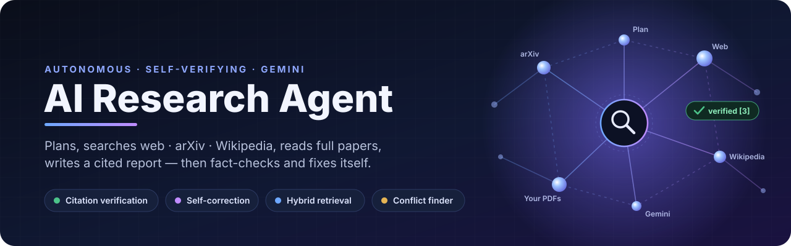
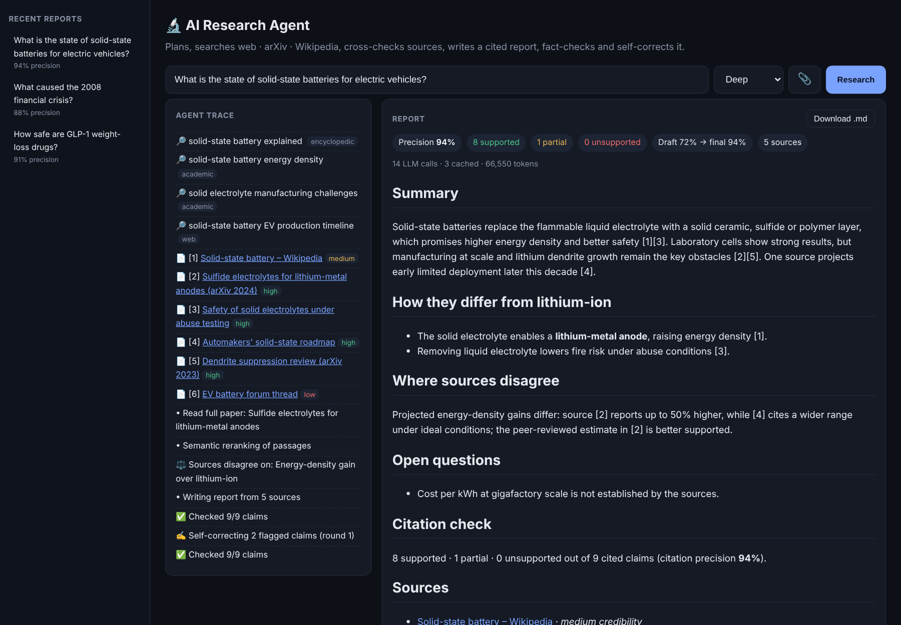
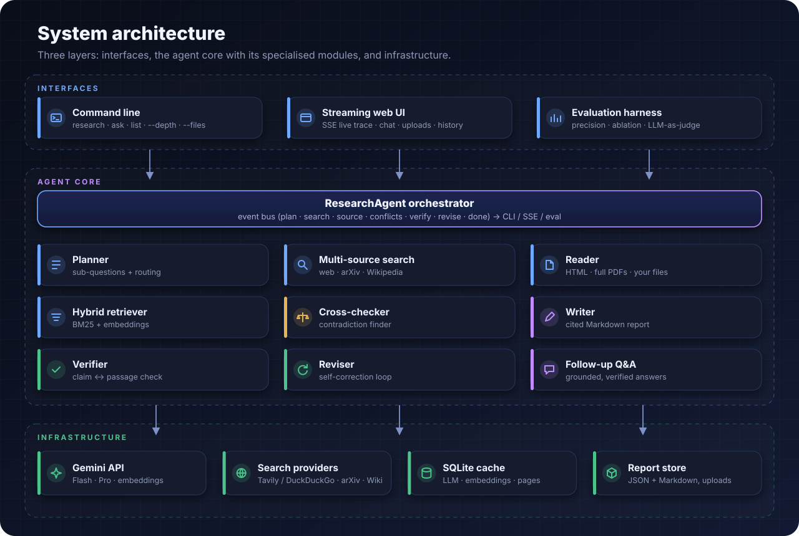
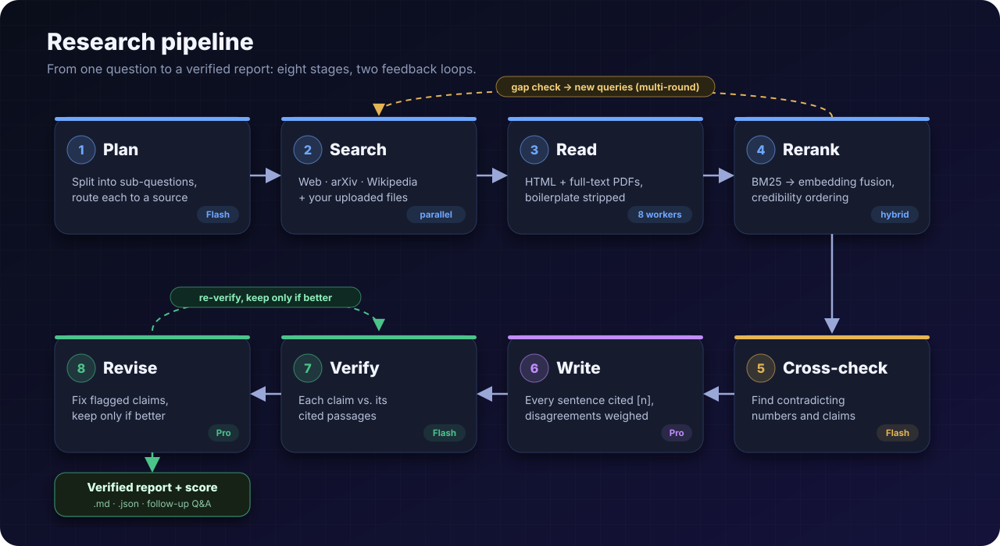
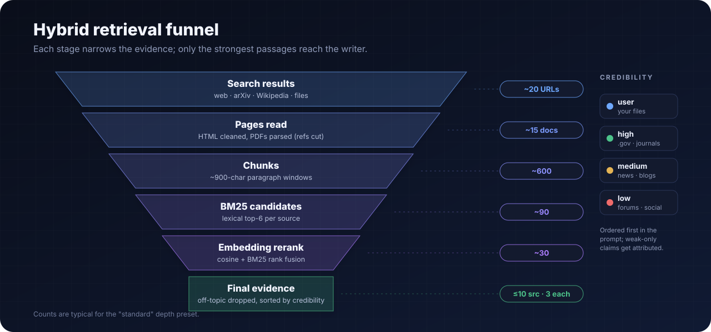
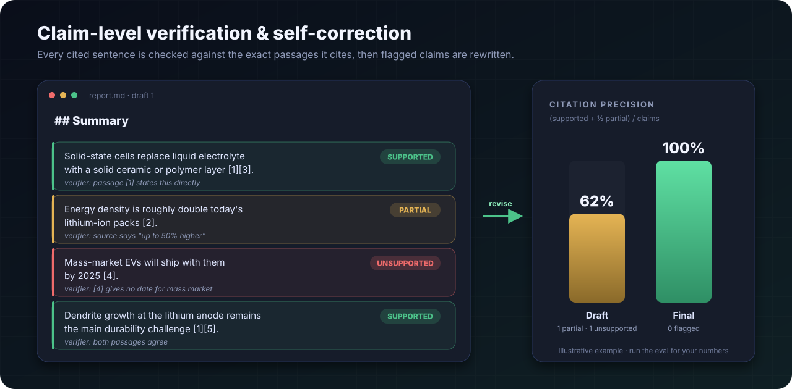

<p align="center">
  
</p>

<p align="center">
  <a href="https://github.com/hemanthkumar1012/AI-Research-Agent/actions/workflows/tests.yml"></a>
  
  
  
  
</p>

An autonomous research agent that **plans, searches the web, arXiv and Wikipedia, reads full
papers and your own documents, writes a cited report, and then fact-checks and corrects its own
citations.** Built in Python on the Gemini API.

Most "research agents" stop at summarising search results. This one treats **hallucinated
citations** as the main failure mode: every cited sentence is checked against the exact passages
it cites, flagged claims are rewritten, and each report ships with a measurable
**citation-precision** score.

<p align="center">
  
  <br><sub>Web UI: the live agent trace (left) and the verified report with its score (right). Demo data.</sub>
</p>

## ✨ Highlights

| | |
|---|---|
| ✅ **Claim-level verification** | Each cited sentence is checked against its cited passages and labelled *supported*, *partial* or *unsupported*. |
| 🔁 **Self-correction** | Flagged claims are rewritten and re-verified. A revision is kept only if precision doesn't drop. |
| 🌐 **Multi-source search** | The planner routes each sub-question to **arXiv**, **Wikipedia** or the **open web**, and the searches run in parallel. |
| 📄 **Full-text PDFs** | Reads whole arXiv papers (references stripped), not just abstracts, plus your own PDFs and notes. |
| 🧲 **Hybrid retrieval** | BM25 shortlists passages, Gemini embeddings rerank them, and off-topic sources are dropped. |
| ⚖️ **Contradiction finder** | Sources are cross-examined for conflicting numbers and claims, and the report weighs each side. |
| 🏷️ **Credibility scoring** | Sources are ranked user > high > medium > low, and claims backed only by weak sources are attributed. |
| 💬 **Follow-up Q&A** | Chat with a finished report. Answers come from the same sources and are citation-checked too. |
| 📊 **Evaluation harness** | Measures citation precision, unsupported rate and LLM-as-judge quality, with an ablation mode. |
| ⚡ **Cost-aware** | A SQLite cache for LLM calls, embeddings and pages, plus per-run token accounting and depth presets. |

## 🏗️ Architecture

<p align="center"></p>

The orchestrator emits a typed event for every step (`plan`, `search`, `source`, `conflicts`,
`verify`, `revise`, `done`). The same agent drives the CLI progress log, the browser's
Server-Sent-Events stream and the evaluation harness, with no duplicated logic.

## 🔬 Research pipeline

<p align="center"></p>

Two feedback loops make it agentic rather than a fixed chain:
- **Gap filling:** after reading, the agent asks itself what's still missing and searches again (multi-round).
- **Self-correction:** after verification, flagged claims are rewritten and re-checked.

## 🧲 Hybrid retrieval

<p align="center"></p>

## ✅ Verification & self-correction

<p align="center"></p>

**Citation precision** = (supported + ½ × partial) / cited claims. The verifier only sees the
passages a sentence actually cites, so a correct fact that cites the wrong source still counts as
a failure. That is deliberate.

## 🚀 Quick start

```bash
git clone https://github.com/hemanthkumar1012/AI-Research-Agent
cd AI-Research-Agent
pip install -r requirements.txt
cp .env.example .env        # add GEMINI_API_KEY (free at aistudio.google.com)
```

**Web UI**

```bash
python -m research_agent.server        # → http://localhost:8000
```

**Command line**

```bash
python -m research_agent "What is the current state of solid-state batteries for EVs?"
python -m research_agent "How safe are GLP-1 drugs?" --depth deep
python -m research_agent "Summarise the risks in this contract" --files contract.pdf notes.md

python -m research_agent list                 # saved reports
python -m research_agent ask <report-id>      # interactive follow-up questions
```

**Docker**

```bash
docker build -t research-agent . && docker run -p 8000:8000 --env-file .env research-agent
```

### Options

| Flag | Default | What it does |
|---|---|---|
| `--depth quick\|standard\|deep` | `standard` | Preset for sub-questions, sources, rounds and revisions |
| `--files PATH…` | – | Your PDFs / Markdown / HTML / text as primary sources |
| `--rounds N` | 2 | Research rounds (gap filling) |
| `--sources N` | 10 | Maximum sources |
| `--revisions N` | 1 | Self-correction passes (`0` = off) |
| `--no-embeddings` | – | BM25 only |
| `--no-conflicts` | – | Skip contradiction analysis |
| `--no-cache` | – | Bypass the SQLite cache |

| Depth | Sub-questions | Sources | Rounds | Revisions | Full papers | Conflicts |
|---|---|---|---|---|---|---|
| quick | 3 | 6 | 1 | 0 | – | – |
| standard | 4 | 10 | 2 | 1 | ✓ | ✓ |
| deep | 6 | 16 | 3 | 2 | ✓ | ✓ |

## 📊 Evaluation

```bash
python -m research_agent.evaluate --limit 3                               # full system
python -m research_agent.evaluate --limit 3 --revisions 0 --out evals/no_revise   # ablation
```

This writes `evals/results/results.md` with, per question and overall:
- **citation precision**: draft → final
- **unsupported-claim rate**
- **LLM-as-judge quality**: coverage, depth, balance and clarity (1–10)
- sources used and latency

Comparing the two runs shows how much self-correction improves grounding.

## 🗂️ Project layout

| File | Role |
|---|---|
| `research_agent/agent.py` | Orchestrator: plan, gather, rerank, cross-check, write, verify, revise, ask |
| `research_agent/search.py` | Web (Tavily / DuckDuckGo), arXiv and Wikipedia providers |
| `research_agent/fetch.py` | HTML and PDF extraction, local files, BM25 passage ranking |
| `research_agent/llm.py` | Dependency-free Gemini REST client: retries, JSON mode, embeddings, usage |
| `research_agent/prompts.py` | All prompts in one place |
| `research_agent/credibility.py` | Domain-based source credibility |
| `research_agent/cache.py` | SQLite cache for LLM, embedding and page results |
| `research_agent/store.py` | Saved reports for history and follow-ups |
| `research_agent/server.py` + `static/` | Streaming web UI (SSE), uploads, chat |
| `research_agent/evaluate.py` + `evals/` | Evaluation harness and question set |
| `tests/` | 24 offline tests with fake LLM and search (no API key needed) |

## 🧪 Tests

```bash
pip install pytest && pytest -q
```

Everything runs offline: the LLM, the search engine and the network are replaced with fakes,
including a hand-built PDF and a live in-process HTTP server for the SSE, upload and chat endpoints.

## 🛣️ Roadmap

- [x] Plan → search → read → write → verify pipeline, multi-round gap filling
- [x] Self-correction loop with regression guard
- [x] Hybrid BM25 + embedding retrieval, credibility scoring
- [x] arXiv full-text PDFs, Wikipedia, user document uploads
- [x] Contradiction detection, follow-up Q&A, report history
- [x] Eval harness with ablation and LLM-as-judge, CI, Docker
- [ ] Public hosted demo
- [ ] Citation-graph view of sources ↔ claims

---

<sub>Built by <a href="https://github.com/hemanthkumar1012">V. Hemanth Kumar</a>.</sub>
